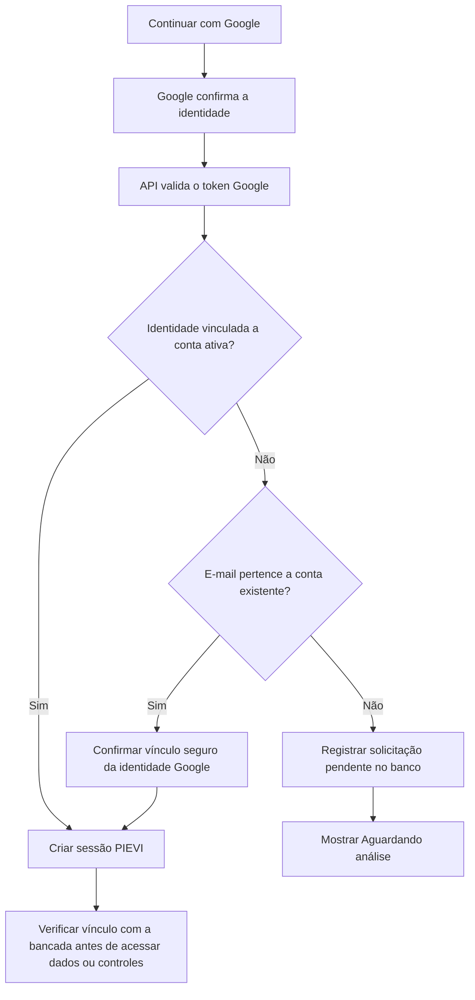

# Acesso pelo Google e solicitações de cadastro

**Estado: login Google e fila pendente implementados para teste Android, 22/10/2026.** O responsável solicitou implementar o recurso antes de repassar o projeto. O destino de avisos, a interface de análise e a aprovação dessas solicitações continuam em definição. A decisão atual de operador único permanece. O [guia Android](../GUIA-ANDROID-EXPO-GO.md) contém a configuração completa do ambiente de teste.

## Fluxo proposto

A autenticação Google confirma quem é a pessoa. A conta ativa e seu vínculo com a bancada continuam determinando o acesso no PIEVI. Um pedido pendente não recebe sessão de operador nem acessa dados/controles.

O armazenamento da solicitação e sua comunicação são decisões separadas. A proposta é guardar a solicitação no PostgreSQL como fonte do estado; uma tela para análise ou um aviso por e-mail pode ser adicionado depois, conforme a escolha do responsável.

## Pessoas já cadastradas

1. O app inicia a autenticação Google com os escopos de identidade necessários (`openid`, `email`, `profile`).
2. A API verifica assinatura, emissor, cliente destinatário, validade e as declarações de identidade usando biblioteca oficial ou equivalente apropriada. Não confia em um e-mail enviado isoladamente pelo app.
3. Se a identidade Google já estiver vinculada a uma conta ativa, usa esse vínculo.
4. No primeiro acesso Google de uma conta local existente, a associação por e-mail exige que o endereço seja confirmado e que a prova de propriedade seja adequada. Para Gmail, o Google é autoridade sobre o endereço; para Workspace, conferir também `email_verified` e `hd`. Para e-mail de terceiro sem essa garantia, exigir confirmação adicional da conta existente antes de vinculá-la.
5. Após o vínculo inicial, a chave persistente é o identificador Google `sub`, não o e-mail. Mudança de e-mail não transfere automaticamente um vínculo para outra pessoa.
6. A API gera sua própria sessão PIEVI, com expiração e revogação. O token Google não substitui a sessão do aplicativo nem dá permissão para operar uma bancada.

Essa separação segue a [verificação de identidade no backend recomendada pelo Google](https://developers.google.com/identity/sign-in/web/backend-auth) e a orientação de usar [`sub` como identificador estável](https://developers.google.com/identity/openid-connect/openid-connect).

## Pessoas ainda não cadastradas

Após confirmar a identidade Google, a API propõe uma solicitação com estado `pendente`. Antes de registrar, o app mostra o que será solicitado e permite confirmar o envio. Repetir a mesma solicitação não cria várias entradas: a identidade Google identifica o pedido existente.

A resposta permite mostrar “Solicitação enviada; aguardando análise”. O pedido por si só não cria operador ativo, vínculo com bancada ou token de acesso aos recursos do sistema.

O destino fica para decisão: consultar uma fila no banco, analisar em uma tela própria ou receber um aviso adicional. Não existe destinatário de e-mail definido, e nenhum envio externo está autorizado por esta proposta.

## Modelo de dados proposto

| Estrutura | Conteúdo e finalidade |
| --- | --- |
| `identidades_externas` | Conta local, provedor `google`, identificador `sub`, data do vínculo e último acesso. Identidade única por provedor/`sub`; vínculo com conta local explícito. |
| `solicitacoes_acesso` | Identidade Google, nome/e-mail informados pelo provedor, estado pendente, criação e atualização. Ainda não há decisão/aprovação implementada. Não é uma conta ativa. |
| `usuarios` | Continua representando contas autorizadas. Se futuramente existirem contas exclusivamente Google, revisar `senha_hash NOT NULL` com uma migração específica, sem criar senhas fictícias. |
| `sessoes` | Reutilizar a sessão PIEVI existente, persistindo só o hash do token. |
| `dispositivo_usuarios` | Continua determinando a autorização sobre cada bancada. |

Uma identidade Google não pode apontar para duas contas. A vinculação, criação da sessão e eventual decisão de pedido precisam de transações e proteção contra repetições. Tokens de identidade Google não são armazenados como histórico da solicitação.

As tabelas de identidade e fila pendente estão em `db/003_google_auth.sql`, aplicável com `npm.cmd run db:migrate-google -w api` na base de desenvolvimento configurada. A implementação não aplicou essa migração automaticamente ao banco do autor. O ciclo de aprovação será definido depois da decisão do responsável.

## Contratos propostos

O fluxo terá uma operação para autenticar a identidade Google e outra para confirmar o envio de uma solicitação quando não houver conta. A confirmação deve usar prova curta de identidade validada pela API, com validade e uso restritos à solicitação; ela não é uma sessão de operador.

Implementado: `POST /v1/auth/google/challenge` cria desafio/nonce de uso único por 5 minutos; `POST /v1/auth/google/login` recebe `challengeId`, `idToken` e senha local opcional para associação segura de e-mail de terceiro; `POST /v1/auth/google/requests` consome um `requestTicket` restrito à confirmação do pedido. Essa prova não permite acesso aos recursos protegidos. Repetições são deduplicadas por `sub`.

| Resultado da identidade validada | Resposta ao app |
| --- | --- |
| Conta autorizada e vinculada | Sessão PIEVI, no formato de login atual |
| Conta existente exige confirmação adicional de vínculo | Orientação de vinculação; sem sessão nova até confirmar |
| Pessoa sem conta e sem solicitação | Exibir confirmação para solicitar acesso |
| Pedido já pendente | Informar o estado existente; sem acesso à bancada |
| Conta desativada ou identidade não aceita | Recusar o acesso; não recriar a conta por outro caminho |

A API não deve disponibilizar nomes/e-mails/status de terceiros por consultas anônimas de IDs de solicitação. A forma de acompanhar pedidos deve continuar associada à identidade que os criou.

## Configuração Google e iPhone

O projeto agora inclui `react-native-nitro-google-signin` com Credential Manager, `react-native-nitro-modules`, `expo-dev-client` e perfil Android EAS. O Android usa `webClientId` explícito e autolinking, sem Firebase. O backend usa `google-auth-library` para validar assinatura e declarações. Os IDs OAuth, o certificado de assinatura e a conta/banco de teste ainda precisam ser configurados pelo colega. O fluxo Google iOS não está habilitado nesta entrega Android.

As bibliotecas de login Google indicadas pelo Expo exigem código nativo e uma **development build**. O Expo também informa que o Expo Go não atende o desenvolvimento/teste desse fluxo OAuth com retorno ao app. A experiência atual no Expo Go continuará servindo para o login local; o teste Google no iPhone exige preparar a versão de desenvolvimento e suas credenciais. Referências: [Google no Expo](https://docs.expo.dev/guides/google-authentication/) e [autenticação OAuth no Expo](https://docs.expo.dev/guides/authentication/).

## Decisões em aberto

- Como o responsável recebe/consulta as solicitações: apenas fila persistida por enquanto, tela de análise ou aviso adicional por e-mail.
- Manter só o operador atual ou permitir futuramente outras contas aprovadas. Aprovar uma segunda conta ativa altera a decisão nº 18; a API atual verifica essa restrição na inicialização.
- Se forem permitidas novas contas, definir quem decide cada solicitação e quais bancadas/ações cada conta poderá acessar antes de implementar a aprovação.
- Definir o projeto/credenciais OAuth Google e o caminho de distribuição da development build no iPhone antes de configurar serviços externos.

O código Google está implementado; a API só o ativa com PostgreSQL, migração Google e `GOOGLE_CLIENT_IDS` configurados. A entrada real no Android exige instalar uma development build com os módulos nativos e configurar os clientes no Google Cloud. Não houve teste no aparelho/Google real nesta máquina. Aprovar usuários ou enviar avisos permanece fora do recurso liberado.
