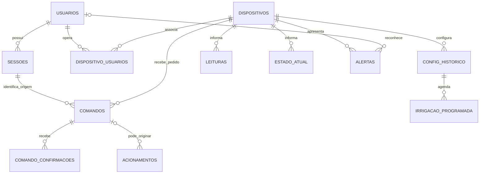

# Revisão do modelo de banco — 22/10/2026

**Resultado:** modelo SQL revisado para avaliação e criação futura. O arquivo original `tmp/db/db_PIEVI.txt` foi preservado. O escopo funcional aprovado continua sendo um operador autenticado, sem perfis diferentes; cadastro público e ampliação de permissões dependem de decisão do responsável.

## Referências e precedência

1. [Decisões aprovadas](decisoes-aprovadas.md): prevalecem sobre as alternativas e os limites divergentes do PDF.
2. [Arquitetura aprovada](arquitetura-proposta.md) e `api/src/contracts.ts`.
3. PDF de estados e falhas, texto extraído em `tmp/pdfs/horta_morangos_tabelas_estados_falhas.txt`.
4. Modelo recebido em `tmp/db/db_PIEVI.txt`.

Hospedagem prevista: PostgreSQL no Railway, conforme `contexto-codex-cli.md`. Plano, região, credenciais, retenção e backups ainda precisam ser definidos antes da implantação.

## Principais achados e ajustes

| Área | Situação no original | Ajuste no modelo revisado |
| --- | --- | --- |
| Usuários | Nome/e-mail, sem identificador de login, senha ou ciclo de vida da conta | `usuario`, nome, contato opcional, hash de senha, ativo e datas; UUID gerado automaticamente |
| Sessões | Ausentes | `sessoes`, com hash do token, expiração, revogação e vínculo com o usuário |
| Permissões | Perfis `admin/operador/leitor` | Versão revisada segue o operador aprovado; associação por bancada com vínculo ativo, sem perfis |
| Comandos | ID interno numérico sem `commandId` externo | Identidade externa única por dispositivo para idempotência; ID interno continua disponível para FKs |
| Ciclo do comando | `executado` não diferencia aceite e término | Pendente, enviado, aceito, concluído, rejeitado e expirado; confirmações MQTT deduplicadas em tabela própria |
| Auditoria | Acionamento aponta a um número sem FK; autor/sessão não garantidos | FKs vinculam sessão ao autor, comando à bancada e acionamento à mesma bomba/comando |
| Limites | Durações sem restrições; boia poderia ser desativada | Configurações e pedidos elegíveis respeitam B1 ≤300 s, B2 ≤60 s, MANUAL_OFF ≤1 h e bloqueio por nível baixo sempre ativo |
| Exceção da boia | Apenas nome do comando | Confirmação de supervisão, operador/sessão, teto de duração e um pedido ativo de exceção por dispositivo |
| Configuração | A view estava só descrita em comentário | `config_atual` implementada, selecionando a maior versão confirmada pelo ESP32; pendências não substituem a configuração aplicada |
| Fallback | Não representado | Agenda por versão de configuração e dispositivo, com horário local e duração |
| Telemetria | Timestamp como chave; faltam indicadores de qualidade | ID de mensagem para deduplicar, horário de recebimento e qualidade de sensores/relógio; amostras distintas no mesmo instante são preservadas |
| Estado manual | Contagem restante armazenada fica desatualizada | Instante absoluto de expiração; app calcula a contagem regressiva |
| Acionamentos/alertas | Faltam identidades externas estáveis de ciclo/episódio | `id_externo` relaciona abertura/início a resolução/fim, mesmo em mensagens diferentes |
| Alertas | Severidade apenas no catálogo e reconhecimento incompleto possível | Episódio guarda severidade/mensagem/ação, autor e data do reconhecimento juntos; reconhecer mantém a condição ativa |
| Integridade | Muitas colunas necessárias aceitavam `NULL` | `NOT NULL`, verificações de faixas, FKs compostas e índices para consulta e deduplicação |

Uma restrição `CHECK` isolada pode aceitar `NULL`; por isso valores obrigatórios também usam `NOT NULL`. As relações entre dispositivos, autores e comandos são asseguradas por chaves estrangeiras, conforme a [documentação de restrições do PostgreSQL](https://www.postgresql.org/docs/18/ddl-constraints.html).

## Cadastro e login previstos pelo modelo

### Identidade

- `usuarios.usuario` mantém o login por usuário; em 22/10/2026, o responsável também solicitou login pelo e-mail cadastrado. A consulta e os índices tratam diferenças de maiúsculas/minúsculas de forma coerente.
- `email` permanece opcional e pode identificar a mesma conta no login, com a mesma senha. O campo e seu índice único já existiam no esquema; essa mudança não exige migração estrutural. Obrigatoriedade, verificação do endereço e recuperação de senha por e-mail continuam fora do fluxo implementado.
- `senha_hash` aceita o formato utilizado pelo backend atual: `salt_hex:hash_scrypt_hex`, com salt de 16 bytes e derivação de 64 bytes. A senha é derivada e comparada na API; o banco recebe somente o hash. Política de senha, custo do algoritmo e limite de tentativas precisam ser definidos/implementados na integração de produção.
- O primeiro operador será provisionado de forma controlada. O modelo não semeia senha conhecida, não cria perfis e não vincula automaticamente todo novo usuário a todas as bancadas.

### Sessão

1. A API procura a conta ativa pelo usuário ou e-mail cadastrado, exige correspondência com exatamente uma conta, verifica a senha com o hash e gera um token aleatório de 32 bytes.
2. O banco guarda o SHA-256 desse token; o token original é entregue ao app e permanece no SecureStore.
3. A sessão usa 8 horas como duração padrão, acompanhando o comportamento atual. A expiração é verificada pelo servidor a cada consulta, mesmo antes de qualquer rotina de limpeza.
4. Cada requisição valida sessão ativa/não expirada, usuário ativo e, para recursos da bancada, vínculo ativo do operador com aquele dispositivo.
5. Logout revoga a sessão. Mudança de senha ou desativação da conta revogam suas sessões por trigger.
6. A criação de sessão revalida o hash e o identificador informado sob bloqueio da linha do usuário, evitando a corrida com uma troca de senha ou de e-mail concorrente.

O verificador do token evita persistir um segredo reutilizável nas linhas de sessão; essa abordagem e a invalidação no servidor seguem a [orientação de armazenamento de sessões da OWASP](https://cheatsheetseries.owasp.org/cheatsheets/Session_Management_Cheat_Sheet.html#server-side-session-token-storage). Hash de token aleatório e hash de senha têm finalidades diferentes.

As FKs não substituem a autorização: vínculos desativados permanecem para preservar histórico. A API deve usar a consulta de autorização e não apenas verificar se a linha da associação existe.

## Relações centrais

O esquema comporta preservação de operadores antigos e futura evolução. A quantidade de contas e o processo de cadastramento são controlados pelo fluxo aprovado da aplicação, não inferidos da existência de várias linhas possíveis.

## O que continua sendo responsabilidade do ESP32 e da API

- **Estado físico:** enviar ou aceitar um comando não atualiza `estado_atual.ligado`. Esse valor vem do dispositivo; os temporizadores continuam locais no ESP32.
- **Falhas observadas:** duração excessiva de um acionamento ou bomba ligada quando o modo é MANUAL_OFF são dados importantes de incidente. O banco permite registrá-los. Os tetos impedem configurações e pedidos elegíveis inseguros; não apagam a evidência de uma falha física.
- **Pedidos recusados:** tentativas rejeitadas/expiradas podem conter uma duração inválida ou validade já vencida para fins de auditoria. A API não reenvia nem executa esses registros. Pedidos malformados fora do vocabulário do protocolo são tratados como erros de entrada.
- **Exceção da boia:** o índice evita dois pedidos ativos de exceção na mesma bancada. A API precisa finalizar/expirar pedidos, e o ESP32 continua garantindo uma bomba por vez e os intertravamentos. Para B2, o teto de 60 s continua valendo também dentro da exceção de até 2 min.
- **Comunicação:** aplicar transições de estado do comando em transação. Confirmação tardia de comando expirado fica no histórico; não reativa o pedido. Deduplicar por dispositivo e `messageId` e rejeitar reutilização do mesmo `commandId` com conteúdo diferente.
- **Identidades de eventos:** usar uma identidade estável por ciclo de acionamento e por episódio de alerta. `mensagem_id` identifica a mensagem inicial; mensagens de término/resolução são registradas em `eventos` e atualizam o mesmo `id_externo`, em transação. Mapear esses campos no contrato MQTT antes da integração física.
- **Ordenação:** a API precisa impedir que mensagens atrasadas sobrescrevam estado/configuração mais recente. O esquema não resolve ordenação entre reinícios do ESP32; o protocolo deve definir correlação e sincronização antes de usar o hardware real.
- **Horário e qualidade:** `ts` é o horário do dispositivo; `recebido_em` é o horário do backend. Com `hora_confiavel=false`, o app usa o horário de recebimento identificado como tal. Isso não fornece ao ESP32 uma hora confiável para executar fallback.
- **Presença:** `online` é um cache de sinalização. A API deve considerar também o último contato e o preset de 45 s, mesmo se o Last Will não tiver chegado.
- **Configuração completa:** salvar a versão e sua agenda de fallback na mesma transação. A view retorna o registro da configuração aplicada; a API carrega sua agenda. Ao criar os presets de bancada, o fallback sugerido é 07h/12h/16h, 60 s, sujeito às proteções aprovadas.
- **Políticas fixas de segurança:** recuperação DHT em 3 leituras; atenção em UR >85% por 30 min; bloqueio por UR ≥98% por 30 min; corte de emergência em UR ≥95%. Esses comportamentos pertencem ao firmware e aos testes de integração; não são executados por triggers do banco.
- **Referências:** IDs internos `bigint` devem ser serializados como strings para o app quando necessário, evitando perda de precisão em JavaScript. O identificador da API (`bancada-01`) é separado do UUID interno e do chip ID.

## Mapeamento para os contratos atuais

| API / contrato | PostgreSQL |
| --- | --- |
| `deviceId` como `bancada-01` | `dispositivos.identificador`; UUID usado nas FKs |
| `PumpId` B1 / B2 | `irrigacao` / `nevoa` |
| `commandId` | `comandos.id_externo` |
| `accepted` / `completed` / `expired` / `rejected` | `aceito` / `concluido` / `expirado` / `rejeitado` |
| `critical` / `warning` / `info` | `critico` / `aviso` / `info` |
| `expiresAt` | `estado_atual.expira_em` ou `sessoes.expira_em`, conforme o recurso |
| `dhtReliable` | `leituras.dht_confiavel` |
| `waterLevel` OK / LOW | `leituras.nivel_ok` true / false |
| Segundos de pausa na API | `pausa_nevoa_min` ×60 na conversão |

A autenticação e a autorização por dispositivo foram integradas posteriormente ao Fastify em 22/10/2026, utilizando o PostgreSQL local quando `DATABASE_URL` está configurada. Veja o [guia de autenticação local](autenticacao-local.md). Os dados e controles do simulador ainda permanecem em memória.

## Política de cadastro aprovada

Em 22/10/2026, o responsável confirmou: **manter operador único e cadastro controlado**. A decisão nº 18 em `decisoes-aprovadas.md` registra essa aprovação e complementa a decisão nº 4.

O operador será provisionado por procedimento controlado no backend, com login por usuário ou e-mail cadastrado e senha, além de vínculo explícito à bancada. O aplicativo não disponibilizará cadastro público. Os perfis admin/operador/leitor do modelo original ficam fora do protótipo; o esquema revisado já corresponde à política aprovada.

O e-mail permanece contato opcional no modelo. Eventual obrigatoriedade, confirmação de endereço e recuperação de senha por e-mail precisam de definição própria antes de implementar esses fluxos. Retenção de telemetria/histórico/sessões, exclusão de conta, plano do Railway e parâmetros ainda não aprovados de duty cycle também precisam ser definidos antes da implantação; não foram arbitrados nesta revisão.

## Validação e implantação

`npm.cmd run test:db` executa 18 cenários em PostgreSQL 18.6 via PGlite 0.5.11, incluindo credenciais, expiração/revogação, vínculo do operador, idempotência, tetos de segurança, configuração aplicada, deduplicação, dados sem leitura, alerta reconhecido ainda ativo e confirmação tardia. O esquema usa recursos disponíveis no PostgreSQL 17+, mas a versão de produção deverá ser confirmada e validada no ambiente de destino.

O resultado da revisão foi um esquema inicial para banco vazio e exemplos de consultas. Depois, o responsável criou esse esquema em um PostgreSQL local 17.6, banco `PIEVI`, e a autenticação da API foi integrada a ele conforme o [guia local](autenticacao-local.md). A implantação no Railway e a persistência dos demais recursos são etapas seguintes. Havendo banco já existente, preparar migração específica; `001_schema.sql` não executa `ALTER TABLE` de conversão nem substitui dados existentes.
